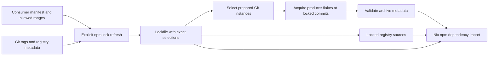
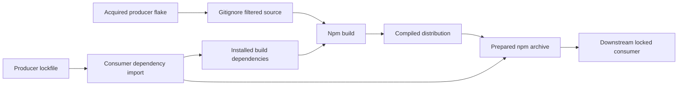

# npm bridge

The bridge connects npm's dependency and lockfile model to Nix-built npm
archives. npm resolves version ranges when a lockfile is refreshed; Nix uses the
selected commits and hashes rather than selecting newer versions during a build.
The bridge is not a general replacement for npm's resolver.

## Authority and acquisition



The [consumer source selector](consumer/sources.nix) validates selected archive
descriptors against the locked package instance. The
[dependency importer](consumer/dependencies.nix) combines prepared archives with
ordinary lock-backed registry dependencies. Advertised runtime providers are
metadata; they do not independently resolve or install a transitive closure.

Automatic selection currently covers scoped Matrix AI Git SSH entries with
40-character locked commits. Other Git entries require explicit prepared
selections or are rejected by the Nix importer. Git override rewriting supports
only the restricted range and instance policy described below.

## Producer and consumer



The [library composition](producer/library.nix) combines the consumer import
with the standard npm build and archive constructors. The separate build output
contains the compiled distribution; the archive is the primary distribution
output and does not bundle its dependency tree. Repository checks remain
independent and are not prerequisites of either output.

### Configure a library

Add `nixpkgs-matrixai` as a flake input. In a per-system scope with `inputs`,
`pkgs`, and `nodejs` already defined, compose a library and export its archive:

```nix
npmLibrary = inputs.nixpkgs-matrixai.lib.npmBridge.producer.libraryFromRoot {
  inherit pkgs nodejs;
  gitignore = inputs.nixpkgs-matrixai.lib.gitignore;
  root = ./.;
  self = inputs.self;
};
```

Use `npmLibrary.npmPackage.out` for `packages.${system}.npm-package` and, if
appropriate, the default package. `npmLibrary.npmBuild` exposes the separate
build output. This composition also acts as a consumer of the library's locked
dependencies. It expects a `package.json`, a `package-lock.json`, an
`npm run build` command, and a build that produces `dist`. Other package shapes
need their own composition or the lower-level helpers.

To make explicit development installs use the prepared archives, put
`npmLibrary.npm` on the development shell's path with higher priority than the
normal npm. For example, in an integrated devenv shell:

```nix
packages = [ nodejs (pkgs.lib.hiPrio npmLibrary.npm) ];
enterShell = ''
  mkdir -p "$PWD/tmp"
  export PATH="${npmLibrary.npm}/bin:$PWD/node_modules/.bin:$PATH"
'';
```

If direnv provides the shell, watch both `package.json` and `package-lock.json`
in `.envrc` so edits can refresh the source plan. An explicit install is still
required after a refresh. The wrapper creates its own temporary directory when
needed, even outside shell activation.

### Producer contract

Every selected Git commit must be accessible to Nix and contain a flake with a
prepared archive at `packages.${system}.npm-package`. For the automatic path,
the locked instance must be an `@matrixai` package resolved as a `git+ssh` URL
with an exact 40-character commit. The archive's `npmPackage` and
`npmDistribution` passthru descriptors must use schema version 1; the standard
library composition constructs them.

The selector checks the archive's package name, version, source revision,
dependency and peer metadata, optional dependencies, engines, and executable
metadata against the locked instance. The distribution descriptor names the
archive output and lists validated runtime-provider candidates. Those candidates
are descriptive metadata, not authority to replace lockfile instances or resolve
additional packages. A semver tag should identify a commit whose package version
matches the tag and whose flake exports the required archive for the target
system.

Source filtering is applied to an already acquired flake tree. It cannot bound
an oversized path-source acquisition. Gitignore rules also do not automatically
exclude unignored paths such as local plans; projects may need narrower source
policies. Producer-flake evaluation cost is separate from source filtering.

## Development installation

```mermaid
flowchart LR
  Edit[Edit manifest or select update] --> Refresh[Explicit lock refresh]
  Refresh --> Review[Review exact lock changes]
  Review --> Reload[Refresh shell source plan]
  Reload --> Wrapper[Explicit npm install or clean install]
  Wrapper --> Backup[Lock and back up canonical files]
  Backup --> Rewrite[Temporarily substitute prepared archives]
  Rewrite --> Npm[Run npm]
  Npm --> Restore[Restore canonical references and release lock]
  Restore --> Modules[Installed dependency tree]
```



The [shell wrapper](consumer/install.mjs) delegates ordinary npm commands and
uses the current prepared-source plan for selected Git dependencies during
install-like commands. A lock refresh is explicit and does not install a new
dependency tree. Reload the shell after a changed lock so its plan refers to the
new selections. Other npm sources remain npm's responsibility; a newly added Git
dependency is not automatically backed by a prepared archive until its lock is
resolved and the plan is refreshed.

The wrapper serializes cooperating installs and retains recovery copies when
restoration fails. Unrelated editors and shells are not locked out and may see
temporary rewrites. Unchanged canonical files retain their modification times
after tested completed operations, avoiding unnecessary watcher invalidation.

## Dependency workflows

Run these commands from the consumer's development shell, where npm is the
shared wrapper. The consumer must have a lockfile, and each selected Git tag
must contain a flake exporting a prepared npm archive with supported metadata.
Git access is required to resolve and acquire Git sources. Ordinary third-party
registry dependencies continue to use their locked npm sources.

The examples use a Matrix AI Git SSH dependency. npm accepts ranges such as
`#semver:^4.1.1` and `#semver:~4.0.x` in dependency declarations. The lockfile
records the exact commit; Nix does not update it during evaluation.

### Version ranges and tags

- `^3.1.3` allows stable versions from `3.1.3` up to, but not including,
  `4.0.0`: compatible minor and patch updates are eligible.
- `~4.0.x` allows stable `4.0` releases below `4.1.0`; `~4.1.1` allows
  versions from `4.1.1` up to, but not including, `4.2.0`.
- Before version 1.0, caret ranges are narrower: `^0.2.3` stops before `0.3.0`,
  and `^0.0.3` stops before `0.0.4`.
- `#v4.1.1` names an exact Git tag rather than a semver range. npm's normal
  prerelease selection rules also apply to semver ranges.

The range is a compatibility policy, not an automatic update. A lock refresh
asks npm to choose among eligible tags; review the resulting exact revision.
Git dependency ranges are npm's feature, while Git override rewriting in the Nix
importer has the narrower limitations described below.

### Add a dependency

Add the dependency to the consumer's manifest:

```json
"@matrixai/async-cancellable": "git+ssh://git@github.com/MatrixAI/js-async-cancellable.git#semver:^4.1.1"
```

Resolve the lock and review the changes:

```sh
npm install --package-lock-only
git diff -- package.json package-lock.json
```

Then follow [install after a refresh](#install-after-a-refresh).

### Upgrade a direct dependency

If the desired version is outside the current range, edit the manifest first.
Otherwise, refresh the dependency within its declared range:

```sh
npm update @matrixai/async-cancellable --package-lock-only
git diff -- package.json package-lock.json
```

Then follow [install after a refresh](#install-after-a-refresh).

### Upgrade a transitive dependency

If the intermediate package declares a compatible Git range, refresh the
transitive package without changing the intermediate's revision:

```sh
npm update @matrixai/async-cancellable --package-lock-only
git diff -- package-lock.json
```

If the intermediate pins an exact tag, either update that intermediate to a
range or add a scoped root override to the consumer's manifest. For a consumer
that depends on the timer package, for example:

```json
"overrides": {
  "@matrixai/timer": {
    "@matrixai/async-cancellable": "git+ssh://git@github.com/MatrixAI/js-async-cancellable.git#semver:^4.1.1"
  }
}
```

After editing the override, resolve and review the lock:

```sh
npm install --package-lock-only
git diff -- package.json package-lock.json
```

Overrides are root-scoped and do not modify the intermediate. The adapter
currently accepts only `^` or `~` followed by three numeric version components
for Git override values. It requires the same Git URL, a matching locked version,
and exactly one selected instance. Wildcard override values and more complex
override cases are rejected rather than treated as general npm support.

Then follow [install after a refresh](#install-after-a-refresh).

### Install after a refresh

Review all lockfile changes, including any unrelated resolutions. Let direnv
reload the shell's source plan at the next prompt. If necessary, run
`direnv reload` and wait for the next prompt before continuing. Projects using
direnv should watch both the manifest and lockfile.

Install the reviewed lock and, when needed, build the producer archive:

```sh
npm ci
nix build '.#npm-package'
```

The lock-only commands do not install a dependency tree and the wrapper disables
install scripts while resolving. Edit the manifest before running them; a
lock-only command that also changes the manifest is rejected and rolled back.
Entering the development shell does not itself install dependencies.

## Verification boundaries

Local Git fixtures have exercised range selection, direct and transitive lock
refresh, prepared installs, and a scoped exact-tag override. They do not
establish complete npm override semantics, every nested or peer dependency case,
recovery under all interruptions, or large-graph memory behavior. A larger
real-producer integration was exercised separately, but it is not a retained
check in this directory.
